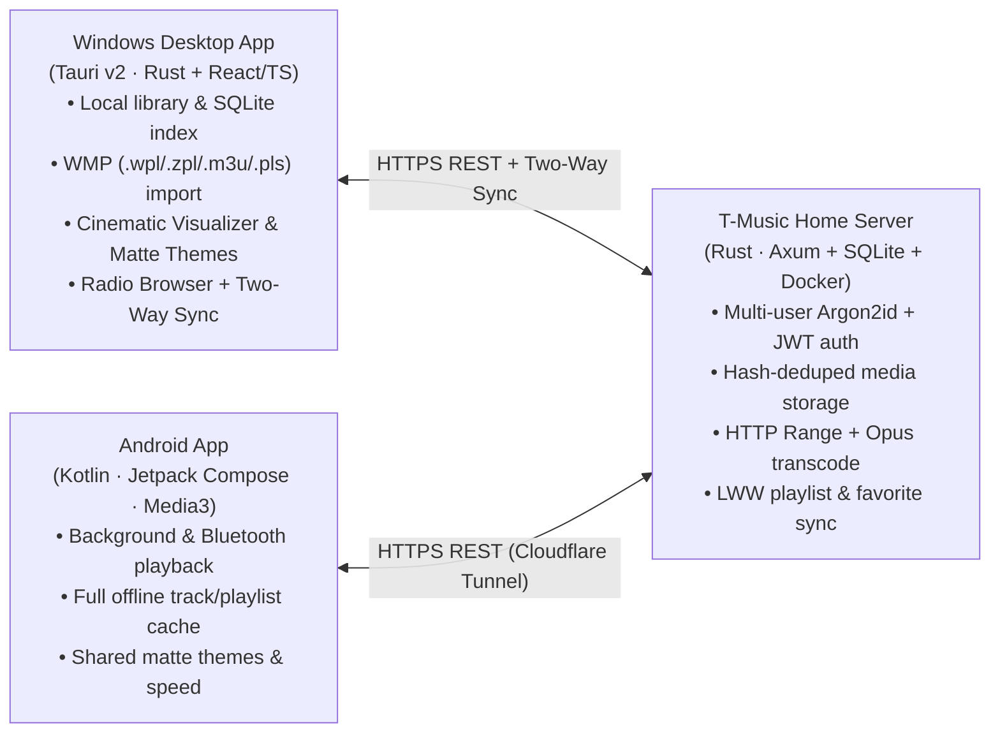

# Architecture — T - MusicPlayer

**T - MusicPlayer** is a multi-user, self-hosted personal music ecosystem engineered across three tiers: a Windows desktop client, a custom Rust home media server, and a native Android companion app.

---

## System Overview

---

## Monorepo Structure

| Path | Responsibility |
| :--- | :--- |
| `crates/t-music-core` | Shared Rust library for audio tag extraction (`lofty`), streaming SHA-256 file hashing, directory walking, SHA-256 cover hashing, WMP/M3U/PLS playlist parsing & export, and sync wire DTOs |
| `server/` | Multi-user Rust (`axum` + `rusqlite` + `argon2` + `jsonwebtoken`) home server with Docker support |
| `apps/desktop` | Tauri v2 desktop client (Rust SQLite + custom `tmusic` HTTP Range/Cover protocol + two-way sync + React/TypeScript/Tailwind UI) |
| `apps/android/` | Native Kotlin + Jetpack Compose + Media3 + Room app tuned for Google Pixel |
| `shared/themes/themes.json` | Portable matte design-token pack shared across Desktop and Android (including **TPX Matte**) |

---

## Home Server API & Two-Way Sync Contract

All remote endpoints live behind HTTPS (such as a Cloudflare Tunnel) and use HS256 Bearer JWT tokens. Credentials, invite codes, and tunnel hostnames are strictly runtime-only and excluded from source control.

- `GET /api/v1/health` — Server status, version, and registration/invite requirements.
- `POST /api/v1/auth/register` & `POST /api/v1/auth/login` — Multi-user account creation (optional `INVITE_CODE`) and JWT login.
- `POST /api/v1/tracks/check-hashes` — Deduplicates track uploads by SHA-256 file content hash.
- `POST /api/v1/tracks/upload` — Streaming multipart upload from desktop to server storage.
- `GET /api/v1/sync/pull` — Returns full visible catalog (`tracks`, `playlists`, `favorites`, `server_time`).
- `POST /api/v1/sync/push` — Last-write-wins sync of user-owned playlists (creation, ordering, soft-delete tombstones) and track favorites (`updated_at` Unix seconds).
- `GET /api/v1/stream/{track_id}` — HTTP `Range` (`206 Partial Content`) original-quality streaming (`?download=1` for attachment disposition, `?quality=saver` for FFmpeg 160 kbps Opus transcode).
- `GET /api/v1/covers/{hash}` — Content-addressed album artwork served with immutable cache headers.

---

## Client Offline & Playback Architecture

- **Desktop (`apps/desktop`)**:
  - Local files stream through custom `tmusic` scheme (`http://tmusic.localhost/...`) with `206 Partial Content` slices and SQLite cover blobs.
  - Pitch-preserved `0.50x–2.00x` speed controls, borderless `F11` fullscreen, persistent settings, and a throttled 60fps canvas Circular Visualizer + Cinematic Mode.
- **Android (`apps/android`)**:
  - `MediaSessionService` + `ExoPlayer` handles audio focus, noisy-disconnect pausing, Bluetooth metadata, and pitch-preserved speed (`PlaybackParameters(speed, 1.0f)`).
  - Room database (`TMusicDatabase`) tracks synced metadata, favorites, playlists, soft-delete tombstones, and downloaded local `filesDir/offline_audio` paths so offline tracks & playlists work with zero connectivity.

---

## Security & Portfolio Hygiene

- All personal server endpoints, JWT secrets, invite codes, and user credentials are strictly runtime-only (`.env` / OS local app data) and listed in `.gitignore`.
- External desktop online playback uses legal public APIs (Radio Browser directory) and user-owned libraries.
