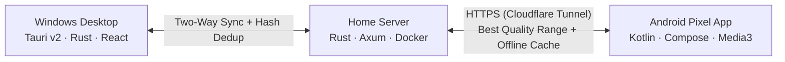

# T - MusicPlayer

A lightweight, fast, multi-user self-hosted personal music ecosystem — built with **Rust**, **Tauri v2**, **React/TypeScript**, and **Native Kotlin / Jetpack Compose**.

> Play your local lossless & MP3 library, migrate legacy **Windows Media Player** (`.wpl` / `.zpl` / `.m3u` / `.pls`) playlists in one click, stream 30,000+ legal Internet Radio stations, enjoy **Cinematic Mode** circular audio visualization, and two-way sync tracks, favorites, and playlists between your Windows PC, Linux home server, and Google Pixel Android phone.

---

## Ecosystem Architecture



- [x] **Phase 1 — Windows Desktop App (`apps/desktop/`)**
  - High-speed Rust directory scanner & tag extractor (`lofty`) backed by local SQLite (`rusqlite`) with SHA-256 deduplicated cover artwork
  - Custom `tmusic` HTTP `Range` byte-streaming protocol for instant FLAC/MP3/Opus/WAV/M4A seeking
  - **Windows Media Player Importer**: Auto-detects `%USERPROFILE%\Music\Playlists` and parses `.wpl`, `.zpl`, `.m3u`, `.m3u8`, and `.pls` with missing-track diagnostics
  - Pitch-preserved playback speed (`0.50x–2.00x`), frameless borderless window + `F11` fullscreen, persistent audio/UI settings, and crisp matte themes without GPU-heavy glow blurs
  - **Cinematic Mode & Visualizer Studio**: Fullscreen circular radial waveform with live-preview tuning (circle size, bar count, sensitivity, mirrored/unmirrored, smooth/raw response, gradient colors, track title position, custom center emblem) and `Esc` to exit
  - 6 matte themes including **TPX Matte** (carbon matte black + neon green with TPX logo) + **Match Album Art** dynamic accent mode
  - Legal online **Internet Radio** browser powered by the open Radio Browser API
- [x] **Phase 2 — Multi-User Rust Home Server (`server/`)**
  - Lightweight Axum + SQLite + Argon2id + JWT media server packaged for Docker behind a **Cloudflare Tunnel**
  - Multi-user accounts with optional `INVITE_CODE` for friends, SHA-256 track deduplication, HTTP `Range` (`206`) best-quality streaming, `?download=1` offline caching, and optional `?quality=saver` FFmpeg Opus transcoding
- [x] **Phase 3 — Two-Way Desktop Sync & Standalone Windows `.exe`**
  - Automatic file hashing & upload from Windows PC to Home Server, plus bidirectional playlist/favorite merging and remote playback
- [x] **Phase 4 — Native Android App (`apps/android/`)**
  - Kotlin + Jetpack Compose + Material 3 + Media3 ExoPlayer app for Google Pixel
  - Full offline track & playlist downloads, two-way PC ↔ Phone sync button, Best Quality + Data Saver options, pitch-preserved speed, and all 6 matte themes

---

## Monorepo Layout

```text
T - MusicPlayer/
├── crates/t-music-core/     # Shared Rust library (tags, SHA-256 scanner, WMP/M3U/PLS parser, sync DTOs)
├── server/                  # Multi-user Rust + Axum + SQLite home server (Dockerfile + API)
├── apps/desktop/            # Tauri v2 + React + TypeScript desktop app + Windows .exe build
├── apps/android/            # Native Kotlin + Jetpack Compose + Media3 Android app (.apk build)
├── shared/themes/           # Shared JSON theme token packs across Desktop & Android
├── docker-compose.yml       # Single-command home server deployment for Docker + Cloudflare Tunnel
└── ARCHITECTURE.md          # System & sync specification
```

---

## Quick Start

### 1. Run Tests Across the Entire Workspace
```powershell
# Rust core, desktop backend, and home server integration tests
cargo test --workspace

# Desktop React/TypeScript build
cd apps/desktop
npm.cmd install
npm.cmd run build
```

### 2. Build Standalone Windows `.exe`
```powershell
cd apps/desktop
npm.cmd run build
cd ..\..
cargo build -p t-music-desktop --release
# Output: target/release/t-music-desktop.exe
```

### 3. Deploy the Home Server (Docker + Cloudflare Tunnel)
See [server/README.md](server/README.md):
```bash
cp server/.env.example server/.env
# Configure ADMIN_PASSWORD, JWT_SECRET, and optional INVITE_CODE
docker compose up -d --build
```
Route your Cloudflare Tunnel hostname (e.g., `https://music.yourdomain.com`) to `http://localhost:8484`.

### 4. Build the Android APK (`apps/android/`)
See [apps/android/README.md](apps/android/README.md):
```powershell
cd apps/android
.\gradlew.bat testDebugUnitTest assembleDebug
# Output: apps/android/app/build/outputs/apk/debug/app-debug.apk
```
